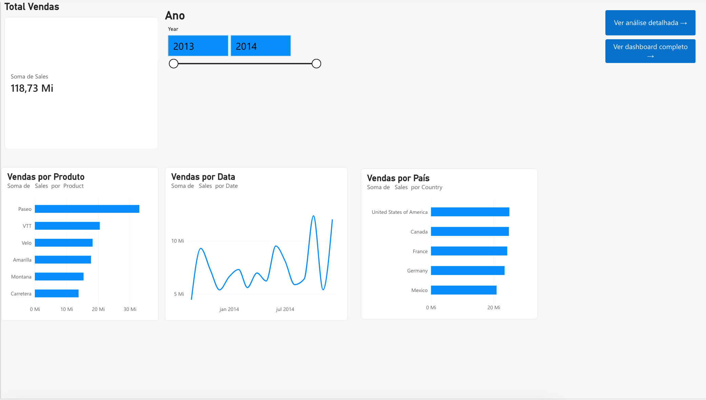

# Desafio 06 — Relatório Interativo com Power BI

## Sobre o projeto

Este projeto apresenta a evolução de um relatório financeiro interativo desenvolvido no Power BI Online, utilizando o conjunto de dados de exemplo **Financial Sample**.

O objetivo é aplicar recursos de visualização, filtros, segmentação de dados e navegação entre páginas, proporcionando uma experiência de análise mais organizada e intuitiva.

O desenvolvimento foi realizado no macOS, utilizando a versão web do Power BI.

## Estrutura do relatório

O relatório está organizado em três páginas:

### Página 1 — Visão geral de vendas

Apresenta:

- Indicador de vendas totais.
- Gráfico de vendas por produto.
- Gráfico de evolução das vendas por data.
- Gráfico de vendas por país.
- Segmentação por ano.
- Botões de navegação para as demais análises.

### Página 2 — Dashboard financeiro

Apresenta:

- Indicadores de vendas, unidades vendidas, descontos, vendas brutas e custos.
- Evolução mensal das vendas.
- Distribuição das vendas por segmento.
- Comparação das vendas por produto.
- Filtro por intervalo de datas.
- Botão para retornar à página inicial.

### Página 3 — Análise detalhada

Apresenta:

- Matriz de vendas por produto e segmento.
- Segmentação de dados por segmento.
- Totalização dos valores de vendas.
- Botão para retornar à página inicial.

## Navegação entre páginas

Foram configurados botões interativos utilizando o recurso **Navegação na página** do Power BI.

Os botões permitem:

- Acessar o dashboard completo a partir da Página 1.
- Acessar a análise detalhada a partir da Página 1.
- Retornar à Página 1 a partir das Páginas 2 e 3.

A navegação foi testada e validada.

## Recursos utilizados

- Power BI Online.
- Visualizações interativas.
- Cartões de indicadores.
- Gráficos de linhas, barras e pizza.
- Matriz de dados.
- Segmentações e filtros.
- Navegação entre páginas.

## Limitações do ambiente

O visual de mapa não pôde ser habilitado devido às permissões disponíveis no ambiente Power BI Online. Essa limitação foi mantida e documentada, sem comprometer as demais funcionalidades do relatório.

## Resultado

O projeto demonstra a construção de um relatório financeiro com múltiplas páginas, indicadores e recursos de navegação, permitindo explorar informações de vendas por produto, país, período e segmento.

## Evidências

## Evidências

### Página 1 — Visão geral

### Página 2 — Dashboard financeiro

### Página 3 — Análise detalhada

