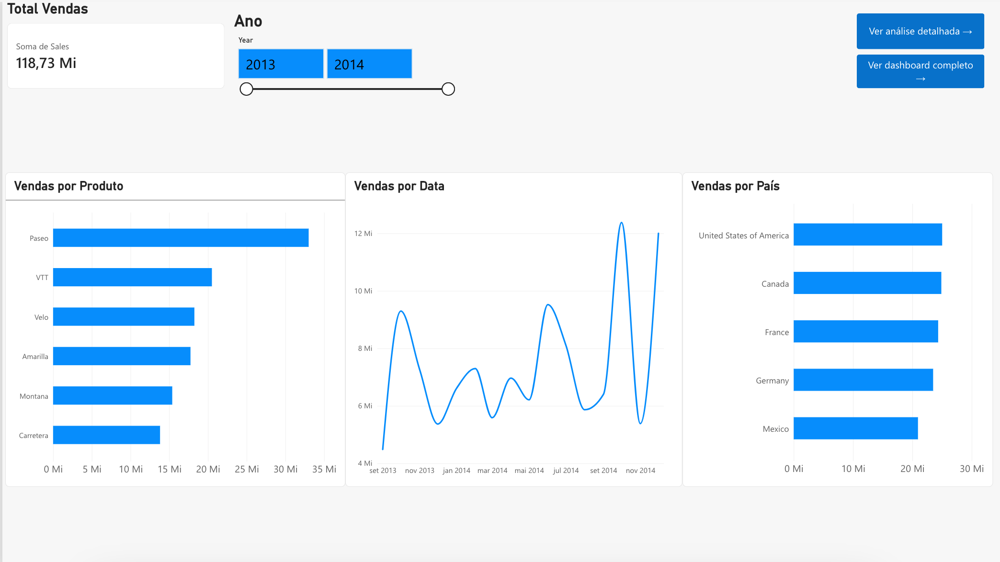
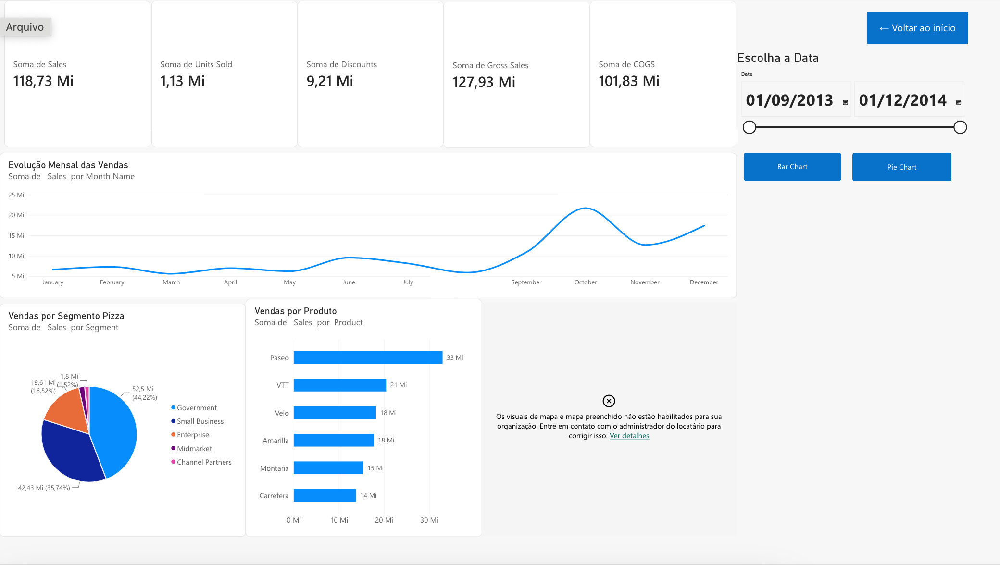
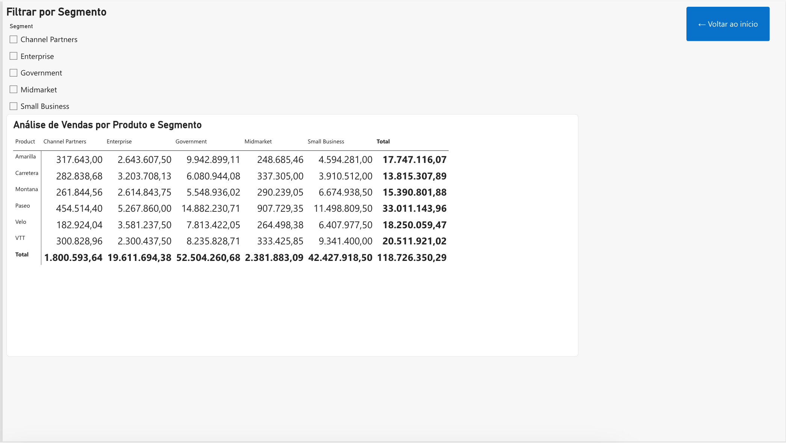

# Desafio 07 — Relatório Interativo com Power BI

## Sobre o projeto

Este projeto apresenta a criação e o aprimoramento de um relatório interativo de análise de vendas utilizando o **Power BI Online**, com base no conjunto de dados de exemplo *Financial Sample*.

O desenvolvimento foi realizado em ambiente **macOS**, utilizando a versão web do Power BI.

## Objetivo

Desenvolver um relatório com múltiplas páginas, recursos de navegação, filtros interativos e visualizações que facilitem a exploração dos dados financeiros.

## Estrutura do relatório

### Página 1 — Visão Geral

Apresenta uma visão resumida do desempenho de vendas, incluindo:

- Cartão de total de vendas.
- Filtro por ano.
- Gráfico de vendas por produto.
- Gráfico de evolução das vendas por data.
- Gráfico de vendas por país.
- Botões para acessar as demais páginas.

### Página 2 — Dashboard Completo

Apresenta indicadores e visualizações para uma análise mais abrangente:

- Total de vendas.
- Unidades vendidas.
- Descontos.
- Vendas brutas.
- Custo dos produtos vendidos (COGS).
- Evolução mensal das vendas.
- Distribuição das vendas por segmento.
- Vendas por produto.
- Filtro por período.

### Página 3 — Análise Detalhada

Permite analisar as vendas por produto e segmento, incluindo:

- Matriz de vendas por produto e segmento.
- Segmentação interativa para selecionar segmentos.
- Botão de retorno à página inicial.

## Recursos implementados

- Relatório com três páginas.
- Navegação por botões entre as páginas.
- Segmentações e filtros interativos.
- Indicadores financeiros.
- Gráficos de barras, linhas e setores.
- Matriz de análise por produto e segmento.
- Organização visual para facilitar a leitura e a navegação.

## Validação

Foram realizados testes de navegação entre as páginas, funcionamento dos botões e interação dos filtros com as visualizações.

Os recursos de navegação e interação foram validados.

## Limitações

O relatório foi desenvolvido na versão online do Power BI. Alguns recursos dependentes de permissões administrativas, como os visuais de mapa, não foram habilitados no ambiente utilizado.

Essa limitação não impediu a construção das demais visualizações e funcionalidades apresentadas.

## Tecnologias utilizadas

- Power BI Online
- Financial Sample
- Modelagem de dados
- Visualização de dados
- GitHub

## Resultado

O projeto resultou em um relatório interativo de análise financeira, com três páginas integradas, permitindo explorar informações de vendas por produto, período, país e segmento.
